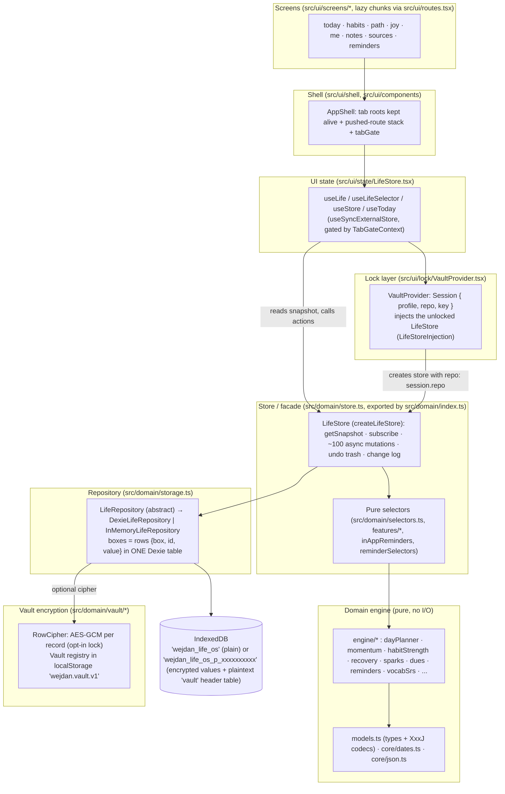
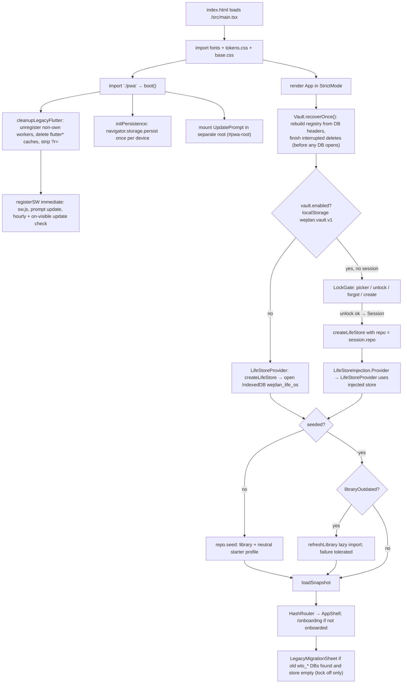

> **ملخص**
> بنية «وجدان» طبقات متدرجة: محرّك النطاق النقي ← المخزن LifeStore ← المستودع (Dexie/IndexedDB) ← طبقة التشفير الاختيارية (Vault) ← حالة الواجهة (LifeStore.tsx) ← الشاشات.
> كل البيانات محلية على الجهاز؛ لا يوجد خادم ولا تحليلات ولا أي طلب شبكة من التطبيق، والتحديثات عبر Service Worker بموافقة المستخدمة.
> تتضمن الوثيقة مخططات Mermaid لتدفق البيانات ودورة حياة الإقلاع والقفل والتحديث والترحيل.

# 05 — System architecture

All statements below were checked against the code at `main` @ `ed0df23` (branch `docs/handoff`, after the release-gate-3 fixes). The missing-features wave (`d982b01`) adds screens, domain helpers under `domain/features`, `domain/studio` and `domain/engine`, and the per-week review-draft API on `LifeStore`; it does not change the layers, the Dexie schema (still v2), the boot sequence or the lock lifecycle below. Wave code map: `04_CURRENT_IMPLEMENTATION.md` §4b. Types/paths are real identifiers.

## 1. Local vs remote

**Everything is local. Nothing is remote.**

- No `fetch(`, `XMLHttpRequest`, `WebSocket`, `EventSource`, `sendBeacon`, analytics or telemetry code exists in `src/` (`grep` of those tokens returned only `navigator.share` in `src/ui/lib/shareFile.ts`, which shares a file the user generated, and a comment in `src/domain/inAppReminders.ts`).
- The only network traffic is the browser loading the static site itself (HTML/JS/CSS/fonts/images from the same origin) and the service worker's own update check for `sw.js` / precache. Fonts are self-hosted (`@fontsource/*`, see `src/ui/fonts.ts`).
- Two outbound **user-initiated navigations** exist: evidence links built by `evidenceUrl()` (`src/domain/models.ts`) that open PubMed/DOI pages in a new tab (`EvidenceScreen.tsx`, `ItemDetailScreen.tsx`), and `tel:` links in Help. These are links, not app requests.
- No accounts, no sync, no backend, no environment variables (see 12_SETUP_AND_ENVIRONMENT.md).

## 2. Layer map



Dependency direction (enforced by convention, verifiable by `grep`):
`ui/*` imports `domain` through the facade `src/domain/index.ts` (66 non-test importers, re-counted) and `domain/vault` (13). `src/domain/**` imports **nothing** from `src/ui` or React (`grep -rnE "from .react|from .\.\./ui" src/domain` returns no match). Engines import `models`, `core/*`, and each other; `store.ts` is the only module that mutates app data during normal use (seeding, import/backup and the vault's copy-migration go through the repository directly).

### 2.1 Domain engine (pure)

- `src/domain/models.ts` defines the entities, enums and per-entity codecs `XxxJ.fromJson/toJson` (forgiving readers from `core/json.ts`). `Settings` carries an `extra` bag for unknown keys.
- `src/domain/engine/*` are pure functions of `(snapshot data, date)`: `dayPlanner.suggestDay` / `planDay`, `momentum`, `habitStrength`, `recovery`, `sparks`, `dues`, `reminders`, `anchors` (uses `adhan` for prayer anchors, off by default), `vocabSrs`, `insights`, `experiments`, `freshStart`, `capacityGuard`, `history`, `whyToday`.
- Time: all day logic uses the **logical day** (`logicalDay`, flips at 04:30 local) and day keys `yyyy-MM-dd`; times of day are minutes since midnight.
- `src/domain/selectors.ts` + `features/*` + `inAppReminders.ts` + `reminderSelectors.ts` are pure read-models `(LifeSnapshot, Date) => value`.

### 2.2 Store / facade — `createLifeStore`

`src/domain/store.ts` → `class LifeStore` (private constructor; `LifeStore.create(o)`; `export const createLifeStore = (o) => LifeStore.create(o)`; re-exported by `src/domain/index.ts`).

- `StoreOptions { repo?, now?, library? }`: repo defaults to `openBestRepository()` (Dexie, falls back to in-memory after a 5 s timeout/failure), `now` is an injectable clock, `library` an injectable action library.
- `create()`: `repo.open()` → `settlePersonalLibrary()` (moves her personal library to where the profile's protection says: encrypted DB row with the lock on, localStorage with it off) → if not seeded, `repo.seed({library, profile: buildStarterProfile(...)})` — **but** if the seeded marker is missing while rows were quarantined and nothing at all is readable, it throws `profile-unreadable` instead of re-seeding over data; else if `repo.libraryOutdated()` → `refreshLibrary(await loader())` (errors swallowed so offline launches keep the stored copy) → `markOpened(today)` → delete leftover focus-block fixed events → `loadSnapshot(repo)`.
- State: one immutable `LifeSnapshot` (`src/domain/snapshot.ts`) held in `this.s`; `getSnapshot()` / `subscribe()` are arrow properties suitable for `useSyncExternalStore`. Each mutation = **write-through to the repository first, then `patch()` → `emit()` publishes a new snapshot object** (listeners notified synchronously).
- Cross-cutting rules implemented in the store: undo trash (`remember`/`undoDelete`, 10 s, memory only), change log (`logChange`, cap 300, restore), import batches serialised with `withBatchLock`, personal-library import (`importPersonalLibrary` → `refreshLibrary` → `reload`), `importAll` (backup first) / `deleteAllAndReseed`.
- There is **no global write queue**: concurrent mutations interleave at `await` points; only import-batch writes are serialised. (Risk, see §7.)

### 2.3 Repository / Dexie

`src/domain/storage.ts`. One Dexie database per profile with two tables (schema `version(2)`; `version(1)` had only `records`):

```
class LifeDb extends Dexie {
  records: Table<{box, id, value}, [string,string]>   // '[box+id], box'
  vault:   Table<{id, value}, string>                  // 'id' — plaintext app-lock header (id 'header'), never exported
}
```

`Boxes` (name → entity) are *logical* collections: every record is a row `{box, id, value}` (primary key `[box+id]`, index `box`). `EntityCollection<T>` gives typed `all/get/put/putAll/delete/clear`. Settings and meta live in box `meta` (`settings`, `moduleState`, `seeded`, `libraryVersion`, `firstRunDate`, `openedDays`). See 11_DATA_STATE_AND_INTEGRATIONS.md for the full box list.

`DexieLifeRepository(name = 'wejdan_life_os', cipher?: RowCipher)`: with a cipher every `value` is sealed on write and opened on read; `box` and `id` stay readable (they are the index). A row that fails to open is **quarantined** (`quarantined()`: `{box, id, reason: 'tamper'|'unreadable'}`), left on disk and skipped, so one bad record never takes the profile down. `readHeader` / `writeHeader` (and the free functions `readDatabaseHeader` / `writeDatabaseHeader`) access the `vault` table through short-lived connections.

### 2.4 Vault encryption (opt-in)

`src/domain/vault/{crypto,credentials,lockPolicy,vault}.ts` + UI in `src/ui/lock/*`. Off by default: with no registry key `wejdan.vault.v1` in `localStorage`, the app uses the plain DB exactly as without the feature. On: each profile has its own username/password/recovery code and its own IndexedDB database whose record values are AES-GCM encrypted, plus a plaintext **header** row (profile record, salts, wrapped key, `rev`, tombstone flags) that mirrors the localStorage registry. `Vault.recover()` runs once per launch before any database opens and rebuilds a lost registry from the headers. The registry is versioned (`rev`, compare-and-set, `BroadcastChannel` `wejdan.vault.registry`). Details and lifecycle in §5.

### 2.5 UI state — `src/ui/state/LifeStore.tsx`

- `<LifeStoreProvider>`: uses `useInjectedLifeStore()` (store handed down by the vault when a profile is unlocked) or opens its own via `createLifeStore()`; on error shows a calm recovery splash; if `!store.persistent` shows the «هالمتصفح ما يحفظ» banner; mounts `<LegacyMigrationSheet>` only when it opened its own plain store (`!injected && store.persistent`).
- Hooks: `useStore()` (actions), `useLife()` (whole snapshot), `useLifeSelector(select, isEqual)` (`use-sync-external-store/with-selector`), `useToday()` (logical today, re-evaluated each minute). All read through `useGatedSource()`: inside a hidden kept-alive tab the hook stops notifying and returns its last snapshot, then catches up once when the tab activates (`state/tabGate.ts`, `TabGateContext`).
- One-time `migrateLocalName`: moves the early build's `localStorage['wejdan.displayName']` into `settings.displayName`.

### 2.6 Screens and shell

`App.tsx` provider order: `ThemeProvider` → `ErrorBoundary scope="app"` → `MotionConfig reducedMotion="user"` → `VaultProvider` → `LifeStoreProvider` → `HashRouter` → `Routes` (`/` → `/today`, `/onboarding`, `*` → `AppShell`). `AppShell` keeps visited tab roots mounted (scroll/state survive), renders at most one pushed route over them (`resolvePushed`, spring slide, swipe-back, focus management), hides the tab bar for `fullscreen` routes, hosts the FAB + `QuickAddSheet`. Every screen is a lazy chunk with retry (`lib/lazyRetry.ts`).

## 3. Data flow: reading and writing

```mermaid
sequenceDiagram
  participant U as User tap
  participant C as Screen component
  participant H as useStore()/useLife()
  participant S as LifeStore (domain/store.ts)
  participant E as Engine/selectors (pure)
  participant R as LifeRepository
  participant D as IndexedDB (Dexie)
  U->>C: «تم» on a plan item
  C->>H: store.completeItem(item, level, opts)
  H->>S: completeItem(...)
  S->>E: isComebackCompletion, awardForCompletion (pure)
  S->>R: repo.logs.put(log); repo.sparkTxns.put(txn); repo.habits.put(...)
  R->>D: records.put({box,id,value[,sealed]})
  S->>S: patch({logs, sparkTxns, habits, projects}) → emit(new snapshot)
  S-->>H: listeners() (useSyncExternalStore)
  H-->>C: new LifeSnapshot (only if tab active / selector slice changed)
  C->>E: todayView(snapshot, today) etc. (pure derived state)
  S-->>C: CompletionResult { log, award, undoUntil }
  Note over C,S: «تراجع» within kUndoWindowMs (10 s) → store.undo(logId) removes log, appends Spark reversals
```

Rules that hold across the store (verified by reading `store.ts`): reads never touch IndexedDB after boot (the snapshot is the source of UI truth; `reload()` re-reads after `importAll`, `restoreBackup`, `deleteAllAndReseed`, personal-library changes); selectors are called during render, so they must stay pure; destructive actions return an `UndoToken`.

## 4. Boot and lifecycle



`<React.StrictMode>` is on in `main.tsx`, so effects run twice in dev.

## 5. Lock lifecycle

```mermaid
stateDiagram-v2
  [*] --> LockOff: no registry
  LockOff --> Migrating: enable lock (password + recovery code shown once)
  Migrating --> Unlocked: backup 'before-lock' → copy to encrypted DB → read-back compare → header → registry (CAS) → fresh-connection proof. Plain DB KEPT as rollback
  Migrating --> LockOff: any failure before the registry write (plain DB untouched, encrypted DB removed)
  Unlocked --> Locked: manual lock (purges device conveniences) / auto-lock (no purge)
  Locked --> Unlocked: right username+password (PBKDF2 → unwrap data key → open DB)
  Locked --> Unlocked: LATER launch + real unlock → finalizeLegacy deletes the plain DB if registry and header agree
  Locked --> Locked: wrong → counter in localStorage, soft delay after 4 free attempts
  Locked --> Unlocked: recovery code → set new password + new recovery code
  Unlocked --> Unreadable: opened but nothing readable (profile-unreadable)
  Unreadable --> Unlocked: retry / import a backup file
  Unlocked --> LockOff: turn off (single profile): decrypt-copy to plain DB, verify, mark encrypted DB retired (durable, read back), drop registry; the encrypted DB is deleted by a LATER launch's recover() only if the plain DB still holds the data (gate 4, eed6603)
  Unlocked --> Unlocked: add second profile (own DB) / switch (via lock)
```



- `VaultProvider` keeps `Session { profile, repo, key }` in React state only; locking sets session `null`, closes the repo, and unmounts the whole app tree (store, screens, toast), so decrypted data is dropped from memory references.
- Crash safety: between every durable step `VaultHooks.step(name)` is a fault-injection point (tests throw `SimulatedCrash` there); at the next launch `recover()` reconciles registry and headers. Unreadable pieces are left in place, never deleted.
- Auto-lock choices `immediate | min1 (default) | min5 | launch` via `visibilitychange` / `pagehide` / `pageshow` + a foreground `setTimeout`. `PrivacyCover` is mounted whenever the lock is enabled.
- The setup overlay (`LockPage` with `portal`) is a modal dialog (focus trap, inert background).
- What the lock does and does **not** protect is spelled out in the header comment of `src/domain/vault/vault.ts` and in `17_SECURITY_AND_LIMITATIONS.md` §2.

## 6. PWA update lifecycle and Flutter takeover

```mermaid
sequenceDiagram
  participant B as Browser
  participant SW as sw.js (workbox, generated by vite-plugin-pwa)
  participant App as App (src/pwa)
  B->>SW: register (immediate) after cleanupLegacyFlutter
  SW-->>B: precache 155 entries; offline-ready
  loop hourly + every visibilitychange→visible
    App->>SW: reg.update()
  end
  SW-->>App: onNeedRefresh (new worker waiting; skipWaiting=false)
  App-->>User: UpdatePrompt «فيه تحديث جديد للتطبيق» with buttons «بعدين» / «حدّثي»
  User->>App: tap
  App->>SW: updateSW(true) → skipWaiting + reload
```

Takeover from the old Flutter build at the same origin/path (`/wejdan-os/`): an old Flutter worker's update check fetches `public/flutter_service_worker.js` (the kill switch), which deletes `flutter*` caches, unregisters itself and navigates its windows to `?r=<ts>`; cached old pages that request `flutter_bootstrap.js` / `flutter.js` / `main.dart.js` hit redirect shims (max 3 hops). `legacyCleanup.ts` then removes any remaining non-`sw.js` registration. IndexedDB is never touched, so the old Hive data stays for the in-app migration.

## 7. Risks and sharp edges (architecture level)

1. **No write serialisation** in `LifeStore` except import batches; two rapid mutations touching the same collection can read a stale `this.s`. Tests (`double-tapped fast creates one task`) cover specific cases, not the general property.
2. **Whole-snapshot load**: `loadSnapshot` reads every box into memory (including the full change log, logs, backups are *not* loaded). Fine for single-user scale; no pagination.
3. **Backups live in the same IndexedDB** (`backups` box) — a browser-storage wipe removes data and backups together; only exported files are off-device.
4. **Undo tokens are in memory**; a reload within the 10 s window loses them.
5. **Action library not precached**: first-ever launch while offline cannot seed.
6. **`base` is hard-coded** in `vite.config.ts` and repeated literally in `index.html` (`/wejdan-os/...` icon/splash links) and the manifest/`navigateFallback`; changing it requires editing all.
7. **Lock counters are advisory** (stored in `localStorage`). **Rollback window**: after enabling the lock the plaintext pre-lock DB stays until a later launch + real unlock (17 §2.2).
8. (resolved in this branch) the `index.html` comment that named a nonexistent generator now names `scripts/brand/generate-brand-assets.mjs`.
