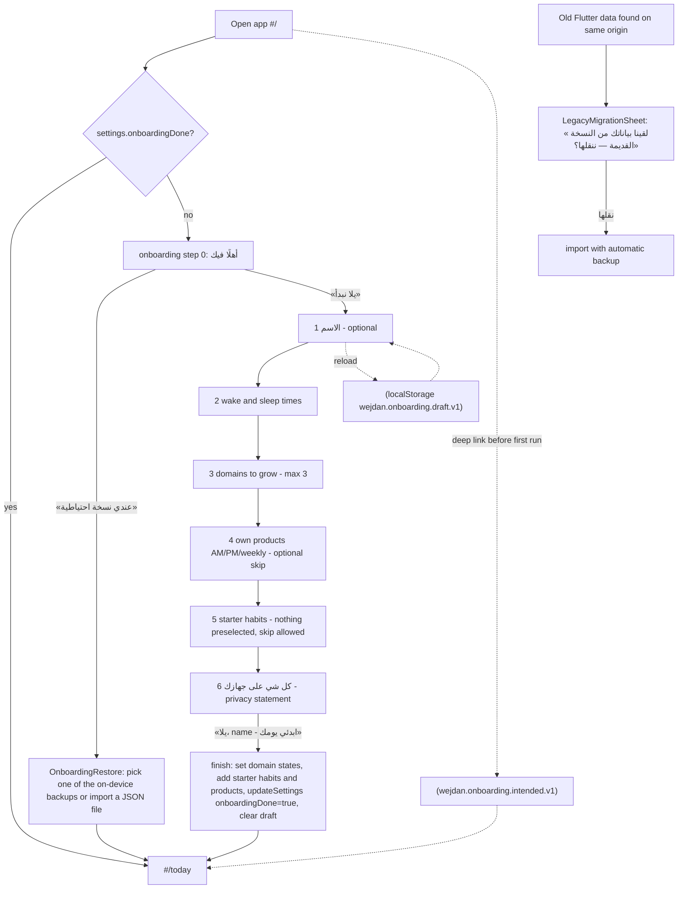
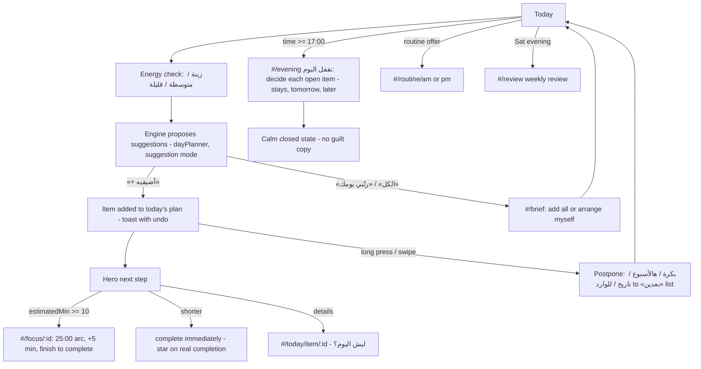
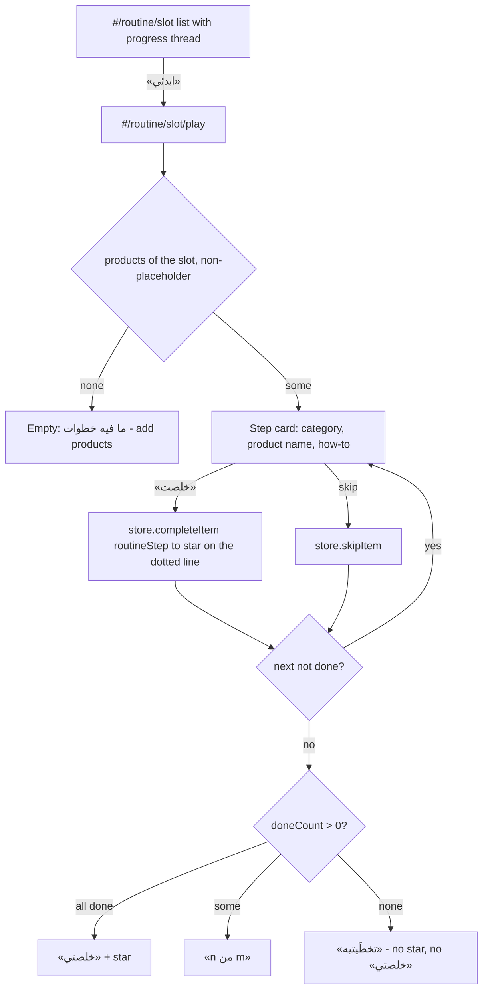
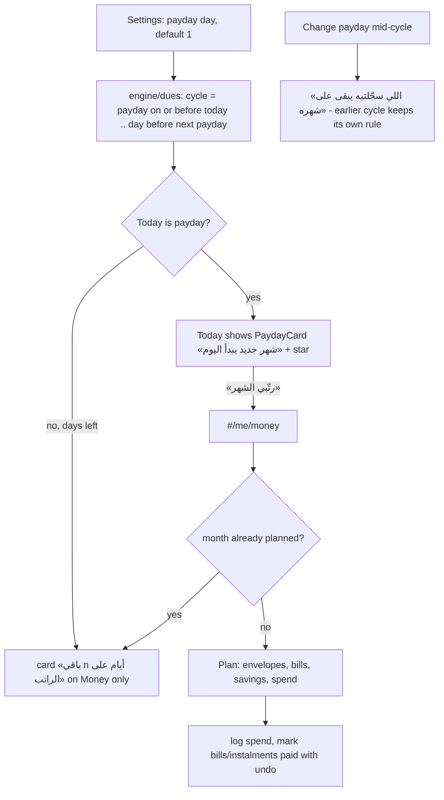
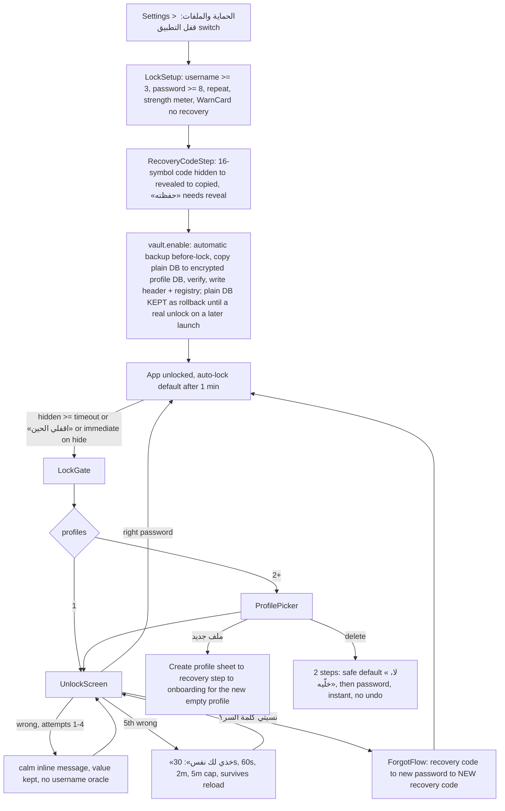
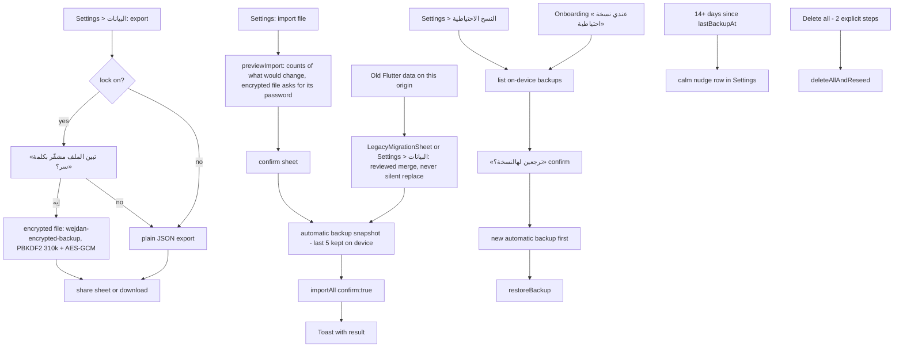

> **ملخص**
> جرد لكل شاشة ومسار في التطبيق (5 تبويبات + التهيئة + 28 شاشة مدفوعة + شاشة مطوّر) مأخوذ من سجل المسارات `src/ui/routes.tsx` ومتحقق منه، مع الملفات والمكوّنات والبيانات والتفاعلات.
> فيه مخططات Mermaid لستة مسارات: التهيئة، الحلقة اليومية، مشغّل الروتين، يوم الراتب، القفل/الفتح، النسخ الاحتياطي والاستعادة.
> لقطات الشاشة (29 صورة، بيانات محايدة باسم test) أُخذت من نسخة `npm run build` الحقيقية؛ وما لم أستطع تصويره مذكور بالاسم.

# 08 — Screens and user flows

Verified 2026-10-24 on branch `docs/handoff` (on top of `main` @ `ed0df23`). Routing is **hash routing** (`HashRouter` in `src/App.tsx`, app base path `/wejdan-os/`); the manifest `start_url` is `/wejdan-os/` and the root hash `/` redirects to `/today`.

## 1. How routing works (verified)

* `src/App.tsx` declares only: `/` → `Navigate /today`, `/kit` → `/me/kit` (**dev builds only**), `/onboarding` (full-screen, no tab bar), and `*` → `AppShell`.
* `src/ui/routes.tsx` is the single registry: `tabRoots` (5 kept-alive tab roots) and `pushed` (29 regex patterns, first match wins; 28 ship, 1 is dev-only) — I counted `pattern: /` = 29 in the file. Each screen is `React.lazy` through `lazyWithRetry` (backoff retry, retry button on the error screen).
* `AppShell` (`src/ui/shell/AppShell.tsx`): keeps tab roots mounted (`TabRoot` memoised, `tabGate` freezes store reads while hidden), pushes screens with a slide + RTL edge-swipe-back (physical direction from `isRtl()`), hides the tab bar for `fullscreen` routes (`/brief`, `/review`, `/me/notes/*`, `/me/sources/review/*`), redirects to `/onboarding` while `settings.onboardingDone` is false (remembering the intended deep link via `onboardingResume.ts`), mounts the FAB + `QuickAddSheet`.
* Cold loads of non-tab roots keep an owner tab underneath (`OWNER_TAB`: brief/evening/focus → today; routine/studio → habits; review/help → me).
* Unknown paths: the `*` route renders the shell; an unmatched pushed path shows an in-shell «ما لقينا…» state (QA deep-link tests, 2026-10-24; **not re-run now**). Unknown ids (e.g. a habit/project/item that doesn't exist) show a «ما لقينا …» empty state — observed now for `/today/item/<unknown>` (screenshot not kept).
* Overlay surfaces outside routing: `LockGate` / `UnlockScreen` / `ProfilePicker` (when locked, `VaultProvider`), `PrivacyCover` (when lock is enabled and the page is hidden), `LegacyMigrationSheet` (old Flutter data offer, `LifeStore`), `QuickAddSheet` (FAB), `SearchSheet` (notes/search, opened from Today/Notes headers), `UpdatePrompt` (own React root `#pwa-root`, «فيه تحديث جديد — حدّثي»), `ErrorBoundary` (app + screen scope).

## 2. Screen inventory — every route in `src/ui/routes.tsx`

Legend: **Data** = store calls / selectors seen in the file (all data is local; see 11_DATA_STATE_AND_INTEGRATIONS.md). **Shot** = screenshot in `docs/handoff/screenshots/` (light/dark = `-light`/`-dark` suffix). **Tests** = vitest files that render the screen. Status for every row: *implemented* unless stated; "console clean" = zero `pageerror`/`console.error` during the capture run on 2026-10-24 (both themes). "Known issues" lists only what I can substantiate now; historical QA findings are in 13_TESTING_AND_QA.md §7 and 14_BUGS_AND_TECH_DEBT.md.

### 2.1 Tab roots (`tabRoots`)

| # | Name | File (lines) | Route | Purpose | Main components | Data | Interactions / animation | Shot · Tests | Known issues / remaining UX |
|---|---|---|---|---|---|---|---|---|---|
| 1 | Today · «اليوم» | `screens/today/TodayScreen.tsx` (543) + `useTodayModel.ts`, `TodayEnergy.tsx`, `RoutineThread.tsx`, `LaterSheet.tsx` | `#/today` | Greeting with name, energy check, the one hero next step, suggestions the engine proposes (she adds with «+ أضيفيه»), routine offer, payday card, evening entry from 17:00 | `Screen` (aurora in dark), `HeroNextStep`, `ListRow`, `CheckCircle`, `PaydayCard`, `PostponeSheet`, `StarMark`, `WMark`, `EnergySegmented` | `useTodayModel` → day plan (`engine/dayPlanner`), `actions.accept/complete/later/dropLater/moveTo/restore/toInbox`, `store.planTask`, settings (name, payday) | hero primary: ≥10 min → `/focus/:id`, else completes immediately; secondary → `/today/item/:id`; swipe/long-press menu on rows (`ContextMenu`, swipe actions); toast with undo; completion star; spring list reflow | `10-today`, `11…` · `tests/ui/today/*` (35 tests) | Console clean. Suggestion mode: nothing is added silently (owner decision). With neutral data and no plan, the hero is the empty «ما فيه شي لازم» state — a populated-plan capture was **not** taken |
| 2 | Habits · «عاداتي» | `screens/habits/HabitsScreen.tsx` (374) + `shared.tsx` | `#/habits` | Three-week grid of planned-habit completion, list of active habits with category flower + streak chip, paused list, starter-habit sheet, entries to garden/routines/products/studio | `Screen`, `InsetGroupedList`, `ListRow`, `Flower`, `StreakChip`, `Chip`, `Sheet`, `EmptyState` | `useLife`, `store.setHabitStatus/skipItem/eveningDecision/addStarterHabits/undo/undoMoveToDate` | tap row → `/habits/:id`; long-press menu (pause, tomorrow, delete…); `/habits/garden`, `/studio`, `/routine/:slot`, `/me/products` | `20-habits` · `tests/ui/habits/habits.test.tsx` (14) | Console clean. In the capture all habits were at stage 1 (seed): stage progression visuals were **not** captured |
| 3 | Path · «مساري» | `screens/path/PathScreen.tsx` (702) + `pathKit.tsx` | `#/path` | Season (quarter) card, domains this season (grow/maintain/rest), goals, projects, ideas, finished | `Screen`, `ProgressArc`, `SegmentedControl`, `Sheet`, `ListRow`, `CheckCircle`, `Toast` | `store.setDomainState/startNewSeason/planProjectStep/deleteGoal/deleteProject/convertInboxWithUndo…` | rows → `/path/project/:id`, IELTS, driving; sheets for domains/goal/project | `30-path` · `tests/ui/path/*` (17) | Console clean. Largest screen file (702 lines) — see debt |
| 4 | Joy · «متعتي» | `screens/joy/JoyScreen.tsx` (254) + `JoyEditSheet.tsx`, `joyModel.ts`, `useRedeem.tsx` | `#/joy` | Things she enjoys, sparks (earned by real completions), one pick for today; entry to rewards | `Screen` (harlequin band), `ListRow`, `Sheet`, `StarMark`, `EmptyState` | `store.completeItem/deleteJoyItem/undo/undoDelete`; day pick in `localStorage` (`joyModel.ts`) | redeem sheet, pick of the day | `40-joy` · `tests/ui/joy/joy.test.tsx` (11) | Console clean. Hard-coded hero colours (see 07 §2.6) |
| 5 | Me · «أنا» | `screens/me/MeScreen.tsx` (150) + `meKit.tsx`, `WeekPriorities.tsx`; `lock/MeProfile.tsx` | `#/me` | Profile header (avatar/name), weekly-review hero, rows to Inbox, Notes, Products, Money, Home & admin, Insights, Evidence, Sources, Change log, Settings, Help; profile switch group | `Screen ground="tinted"`, `InsetGroupedList`, `ListRow`, `WMark`/`ProfileAvatar`, `StarMark` | `useLife` selectors; `localStorage` `wejdan.reviewRest` | «بعدين» rests the review card for today (per-device) | `50-me` · `tests/ui/me/me.test.tsx` (6) | Console clean |

### 2.2 First run

| Name | File | Route | Purpose | Notes |
|---|---|---|---|---|
| Onboarding | `screens/me/OnboardingScreen.tsx` (317) + `OnboardingRestore.tsx` (155), `Onboarding.module.css`, `state/onboardingResume.ts` | `#/onboarding` (declared in `App.tsx`; not in `routes.tsx` `pushed`, exported as `OnboardingScreen`) | 7 states: 0 welcome → 1 name → 2 wake/sleep → 3 domains to grow → 4 own products (AM/PM/weekly) → 5 starter habits (nothing preselected) → 6 privacy («كل شي على جهازك»); also «عندي نسخة احتياطية» restore branch | `STEPS = 6`; progress `role` with `aria-valuetext` «الخطوة n من 6»; draft kept in `localStorage` (`wejdan.onboarding.draft.v1`) so a reload resumes; `finish()` writes domains, starter habits, products, settings (`displayName`, `wakeMinute`, `sleepMinute`, `onboardingDone: true`). Shots `01…04`. Console clean |

### 2.3 Pushed screens (`pushed`)

| # | Name | File (lines) | Route pattern | Purpose | Main components | Data | Interactions / animation | Shot · Tests | Known issues / remaining UX |
|---|---|---|---|---|---|---|---|---|---|
| 1 | Item detail «التفاصيل» | `today/ItemDetailScreen.tsx` (194) | `#/today/item/:id` | «ليش اليوم؟»: reason, evidence (verified-source star), size today, actions | `Screen`, `SegmentedControl`, `InsetGroupedList`, `StarMark` | `actions.accept/complete/skip/later/restore/uncomplete`, `store.setPlannedLevel` | level segmented; → `/focus/:id`, `/habits/:id` | not captured with a real item · `today.test.tsx` | **Not captured**: my seeded ids were habit ids, not plan-item ids, so the screen rendered its «ما لقينا الخطوة» state (valid but not the real screen) |
| 2 | Morning brief | `today/MorningBriefScreen.tsx` (218) | `#/brief` (fullscreen) | Full list of today's suggestions with energy, add all / arrange myself | `Button`, `WMark`, `Bidi`; own CSS (blur) | `actions.accept/acceptAll/acceptRoutine/remove`, `store.setEnergy` | 16 motion usages; close → `/today` | `12-brief` · `tests/ui/today/*` | Console clean |
| 3 | Evening close «نقفل اليوم» | `today/EveningScreen.tsx` (190) | `#/evening` | Decide what stays/moves, calm close | `Screen`, `StarMark`, `Toast` | `store.eveningDecision/restoreFromLater/undo/undoMoveToDate/updateTask` | decisions with undo | `13-evening` | Console clean |
| 4 | Focus «جلسة تركيز» | `today/FocusScreen.tsx` (182) + `focusSession.ts` | `#/focus/:id` | One open arc, one number; 25 min default; extend by 5 | `ProgressArc`, `Button` | `actions.complete`; session persisted in `localStorage` (per-device, not exported); wall-clock ticks; best-effort screen wake lock | start/pause/resume/finish | `72-focus-free-session-light` (unknown id ⇒ «جلسة تركيز حرّة») · `today.test.tsx` | QA area 1 reported `extend()` not clamping elapsed time; the current code does `Math.min(elapsed, totalSec)` before adding 5 min (verified by reading the file now; behaviour not re-run) |
| 5 | Garden «حديقتي» | `habits/GardenScreen.tsx` (151) | `#/habits/garden` | Each habit = its category's flower at its strength stage; beds of three | `Flower`, `SegmentedControl` (list ⇄ garden), `ListRow` | `useLife` | tap flower → `/habits/:id`; growth rise animation (static when reduced) | `22-garden` · `garden.test.tsx` (7) | Seed stage only captured |
| 6 | Habit detail | `habits/HabitDetailScreen.tsx` (281) + `StreakHero.tsx` | `#/habits/:id` (`?recover=1` opens recovery) | Streak/momentum hero with WeekDots, tiny version, reminder, recovery («تعثّرت فيها؟») | `Flower`, `Sheet`, `StreakHero` | `store.acceptDesignChange/deleteHabit/proposeRecovery/startRecovery/setHabitStatus/upsertHabit/undoDelete` | edit → `/studio?`; reminder → `/me/reminders` | `21-habit-detail` · `streakReminders.test.tsx` | Console clean |
| 7 | Routine «روتيني» | `habits/RoutineScreen.tsx` (207) | `#/routine/(am\|pm\|weekly)` | Product steps of a slot with progress thread; pause slot | `StarDottedLine`, `CheckCircle`, `SegmentedControl` | `store.completeItem/skipItem/moveToLater/setRoutineSlotPaused/undo` | → `/routine/:slot/play`, `/me/products` | `23-routine-am` · `habits.test.tsx` | Empty state when no products (neutral data) |
| 8 | Routine player | `habits/RoutinePlayerScreen.tsx` (155) | `#/routine/(am\|pm\|weekly)/play` | One step at a time; star lands only if ≥1 step was done | `StarDottedLine`, `StarMark`, `Button` | `store.completeItem/skipItem` | step card slide (spring `smooth`; fade when reduced) | `24-routine-player` (empty state only) · `area2.test.tsx` | Player with real steps **not captured** (needs her products) |
| 9 | Products «منتجاتي» | `habits/ProductsScreen.tsx` (447) | `#/me/products` | Her care products per slot; seeded generic ones are suggestions until added | `Switch`, `Chip`, `Sheet`, grip reorder + up/down buttons | `store.upsertProduct/deleteProduct/reorderProducts/undoDelete` | drag reorder (+ non-drag alternative) | `25-products` | — |
| 10 | Habit studio «عادة جديدة» | `habits/HabitStudioScreen.tsx` (377) | `#/studio` | Create/edit a habit: name, category (flower), schedule, time, tiny version | `Chip` grid with flowers, `TimeField`, `Sheet`, `SegmentedControl` | `store.upsertHabit`; `DomainWakeSheet` wakes a resting domain | validation next to the field | `26-studio` | Console clean |
| 11 | Project detail | `path/ProjectDetailScreen.tsx` (383) | `#/path/project/:id` | Steps, minutes, notes autosave (debounced), «حطيها لليوم» | `ProgressArc`, `StarDottedLine`, `Chip`, `CheckCircle` | `store.markProjectStep/planProjectStep/patchProject/deleteProject/...` | step edit sheet | not captured (needs a project) · `path.test.tsx` | **Not captured** |
| 12 | IELTS | `path/IeltsScreen.tsx` (582) | `#/path/ielts` | Daily plan, 7-column week grid, mock tests (bands), vocab cards (SRS) | `StarDottedLine`, `Sheet`, `ListRow` | `store.addMockTest/addVocabCard/reviewVocab/setHabitStatus/setDomainState…` | add/edit sheets | `31-ielts` · `path.test.tsx`, `qaArea3.test.tsx` | Large file |
| 13 | Driving licence «رخصة القيادة» | `path/DrivingScreen.tsx` (262) | `#/path/driving` | Generic licence steps template, sessions log | `Switch`, `StarDottedLine` | `store.addDrivingSession/upsertProject/upsertWeeklyTask…` | toggle plan | `32-driving` | Generic template, no personal data |
| 14 | Rewards «مكافآتي» | `joy/RewardsScreen.tsx` (179) | `#/joy/reward` | Self-set rewards priced in sparks + milestone rewards | `StarMark`, `ListRow` | `store.deleteJoyItem/undoDelete`, `useRedeem` | redeem confirm sheet | `41-rewards` | QA area 4 #1 (redeem pill not tappable) fixed per later QA; not re-verified |
| 15 | Inbox «الوارد» | `me/InboxScreen.tsx` (319) | `#/me/inbox` (`?focus=<id>` from search) | Captured items + tasks planned for later/finished | `ContextMenu`, `ListRow` | `store.quickAdd/archiveInbox/convertInboxWithUndo/planTask/postponeTask/…` | convert to task/idea/note/link | `51-inbox` | — |
| 16 | Money «المال» | `me/MoneyScreen.tsx` (666) + `moneyModel.ts` | `#/me/money` | Payday-based budget cycle, envelopes, bills & instalments (BNPL), wishes | `PaydayCard`, `Switch`, `Sheet`, `SegmentedControl` | `store.upsertEnvelope/upsertBill/setBillPaid/upsertBnpl/deleteWish…`; `engine/dues.ts` | pay from row, pause, undo; amounts via `parseAmount` | `52-money` · `tests/ui/money/area4.test.tsx` (20), `paydayCycle.test.ts` (9) | Console clean. Currency via `riyal()` / digits-only LTR isolate |
| 17 | Weekly review «المراجعة الأسبوعية» | `me/WeeklyReviewScreen.tsx` (450) + `reviewDraft.ts`, `WeeklyReview.module.css` | `#/review` (fullscreen) | Ceremonial cover then guided questions; draft per week in `localStorage`; ends with a summary of what it changed | `StarDottedLine`, `Switch`, `Chip` | `store.saveWeeklyReview/dropFromLater/returnTaskToInbox/setHabitStatus/updateTask` | cover with harlequin pattern + aurora | `53-review` | Hex colours (07 §2.6) |
| 18 | Patterns «الأنماط» | `me/InsightsScreen.tsx` (85) | `#/me/insights` | Patterns in words, ≤1 number per row | `ListRow` | `useLife` (engine insights) | — | `54-insights` | — |
| 19 | Evidence «الأدلة والمصادر» | `me/EvidenceScreen.tsx` (151) | `#/me/evidence` | Searchable neutral evidence library per action; women's-health actions hidden unless the private module is on | `ListRow`, `Sheet`, `StarMark` | `useLife` (actions) | Arabic-folded search | `55-evidence` | Library is the neutral bundled one |
| 20 | Home & admin | `me/HomeAdminScreen.tsx` (154) | `#/me/home` | Documents and renewals | `Sheet`, `Button` | `store.upsertAdminDoc/deleteAdminDoc/undoDelete` | — | `56-home` | — |
| 21 | Reminders «تذكيرات» | `reminders/RemindersScreen.tsx` (198) + `SettingsRows`, `ReminderTimeSheet`, `TimeWheel`, `CalendarExportSheet` | `#/me/reminders` | In-app reminders: master switch, time per routine/habit, quiet hours, `.ics` export for real phone alerts | `Switch`, `Sheet`, `TimeWheel` | `store.updateSettings/upsertHabit`; `domain/inAppReminders.ts`, `ics.ts` | `TodayReminderBanner` appears on Today while the app is open (slide 16px + fade) | `57-reminders`, `82-reminder-banner-light`, `83-ics-ready-light` · `streakReminders.test.tsx` (23), e2e `streakRemindersLogo` | **No push notifications exist by design**; real alerts only via calendar import; UID-based re-import on iOS NOT VERIFIED (device) |
| 22 | Settings «الإعدادات» | `me/SettingsScreen.tsx` (427) + `lock/ProtectionSection.tsx`, `lock/backupIO.tsx` | `#/me/settings` (`?s=data`/`?s=import`) | Appearance (system/light/dark), day settings, payday day, flexible streak, private module, sources link, **protection (lock, auto-lock, change password, new recovery code, profiles)**, export/import, automatic backups + restore, personal library import, delete-all (two steps) | `Switch`, `SegmentedControl`, `Sheet`, `TimeField` | `store.exportAll/importAll/previewImport/listBackups/restoreBackup/importPersonalLibrary/removePersonalLibrary/deleteAllAndReseed/updateSettings/setPayday` | see flow 6.6 and 6.5 | `58-settings`, `71…` (capture script) · `me`, `area5`, `streakReminders`, `lockUi` tests | Console clean |
| 23 | Help & safety «المساعدة والسلامة» | `me/HelpScreen.tsx` (76) | `#/help` | Emergency numbers first, health-line numbers, "when to seek help" list | `InsetGroupedList`, `ListRow` | none (static copy carried from the Flutter build) | tel: links | captured, not stored (size budget) | Copy carried from the old build; number accuracy **NOT VERIFIED now** |
| 24 | Notes list «ملاحظاتي» | `notes/NotesScreen.tsx` (222) + `notesKit.tsx`, `SearchSheet.tsx`, `LinkedNotes.tsx` | `#/me/notes` | Notes & decisions, pinned first, filter, global search | `ContextMenu`, `SegmentedControl`, `StarMark` (decision) | `store.deleteNote/setNotePinned/undoDelete` | → editor | `60-notes` · `tests/ui/notes/notes.test.tsx` (8) | Console clean |
| 25 | Note editor | `notes/NoteEditorScreen.tsx` (369) | `#/me/notes/new` and `#/me/notes/:id` (fullscreen) | Title/body, "decision" switch, link to project/habit; autosaves while typing, flushes on hide/leave | `Switch`, `SegmentedControl`, `Toast` | `store.addNote/updateNote/deleteNote/undoDelete` | create-on-first-autosave then updates the same note | `61-note-new` | Existing-note state not captured |
| 26 | Sources «المصادر» | `sources/SourcesScreen.tsx` (255) | `#/me/sources` | Files imported on-device (JSON/CSV/MD…), pending review, unreadable files with reason | `ContextMenu`, `Sheet` | `store.startImport/discardImport/removeSource/undoDelete` | file picker; parse in the browser | `62-sources` · `sources.test.tsx` (8) | — |
| 27 | Import review | `sources/ImportReviewScreen.tsx` (629) | `#/me/sources/review/:id` (fullscreen) | Approve/edit/ignore each found item; only approved items are added to inbox/ideas/notes, never to today | `Chip`, `ContextMenu`, `TimeField`, `Sheet` | `store.commitImport/decideAll/editCandidate/reviewCandidate` | — | not captured (needs an imported file) | **Not captured** |
| 28 | Change log «سجل التغييرات» | `sources/ChangeLogScreen.tsx` (279) | `#/me/changelog` | Important edits/deletes grouped by day with a way back | `SegmentedControl`, `Button` | `store.restoreChange` | restore is itself logged | `63-changelog` | — |
| dev | Kit gallery | `me/KitScreen.tsx` (211) | `#/me/kit`, `#/kit` | Component gallery | all components | — | — | n/a | **Dev builds only** (`import.meta.env.DEV`); not in production bundle routes |

Coverage check (script run during this handoff): routes in `pushed` = 29; rows above = 28 pushed + 1 dev; tab roots 5; onboarding 1. Every screen file imported from `routes.tsx` appears above. No screen file under `src/ui/screens/**` is unreferenced except the four `preview/preview.tsx` dev harnesses (each with an `index.html` that is **not** part of the build).

Screens not reachable by a route but part of flows: `LockGate`, `UnlockScreen`, `ProfilePicker`, `RecoveryCodeStep`, `LockSetup`, `ForgotFlow`, `ProfileSheets` (`src/ui/lock/*`), `LegacyMigrationSheet`, `QuickAddSheet`, `SearchSheet`, `PostponeSheet`, `DomainWakeSheet`, `JoyEditSheet`, `ReminderTimeSheet`, `CalendarExportSheet`, `UpdatePrompt`.

## 3. Captured screenshots (real, from the production build)

Method: `npm run build` → copy of `dist` under `<tmp>/wejdan-os/` → `python3 -m http.server 6403` (PID recorded, stopped by PID) → Playwright 1.47.2 + Chromium 141 (`/opt/pw-browsers/chromium`, `--headless=new`), viewport 390×844, `deviceScaleFactor` 2 (stored downscaled to 390×844, 48-colour PNG to keep the folder at ≈680 KB), `ar-SA`, `Asia/Riyadh`, service worker blocked, time pinned to Wed 2026-10-07 16:50 by a `Date` subclass (not `page.clock`). Data: onboarding name `test`, four neutral starter habits, synthetic logs; nothing personal. Scripts: `docs/handoff/tools/capture-screens.mjs` (+ e2e scripts for lock/reminder shots).

| File | Screen | Theme |
|---|---|---|
| `01-onboarding-welcome-light.png` | Onboarding welcome | light |
| `10-today-{light,dark}.png` | Today | both |
| `12-brief-{light,dark}.png` | Morning brief | both |
| `20-habits-{light,dark}.png` | Habits | both |
| `21-habit-detail-{light,dark}.png` | Habit detail with flexible-streak hero | both |
| `22-garden-{light,dark}.png` | Garden (seed stage) | both |
| `30-path-{light,dark}.png` | Path | both |
| `40-joy-{light,dark}.png` | Joy | both |
| `50-me-{light,dark}.png` | Me | both |
| `52-money-{light,dark}.png` | Money | both |
| `58-settings-{light,dark}.png` | Settings | both |
| `60-notes-{light,dark}.png` | Notes | both |
| `70-quick-add-sheet-light.png` | Quick-add sheet over Today | light |
| `72-focus-free-session-light.png` | Focus (free session) | light |
| `80-lock-unlock-light.png` | Unlock screen (from e2e `lockProfiles`) | light |
| `81-lock-profile-picker-light.png` | Profile picker (e2e) | light |
| `82-reminder-banner-light.png` | In-app reminder banner on Today (e2e `streakRemindersLogo`) | light |
| `83-ics-ready-light.png` | Calendar file ready sheet (e2e) | light |

Screens `01`–`72` were captured on the first-draft build (`4fa6dcc`); `80`–`83` were re-captured on the final tree (`2b7a096`, in-flow reminder banner). The gate-3 changes do not alter the other screens. Captured but not stored (size budget): the remaining routes in both themes (`11…63`, 36 light + 36 dark images, all rendered without console errors: `_log-light.json`, `_log-dark.json` = `errors: [], skipped: []`). Re-run `capture-screens.mjs` to regenerate them.

**Could not capture:** item detail with a real plan item; project detail; import review; existing note; routine player with real steps; flower stages above seed; streak states other than those seeded; payday-day variants; toast/undo states beyond e2e; Help screen kept out of the repo set by choice; all iOS-specific behaviour (standalone display, safe areas, Dynamic Type, status bar, splash) — **no iOS device or simulator available**; keyboard-driven flows with the iOS software keyboard.

## 4. Tab bar and navigation facts

* Tabs (`TABS` in `TabBar.tsx`): اليوم · عاداتي · مساري · متعتي · أنا (keys `today habits path joy me`). Tab roots stay mounted; their store reads freeze while hidden.
* Pushed screens slide in from the physical side that depends on direction (RTL: from the left edge moving right-to-left swipe-back from the right edge), focus moves to the title (`stackFocus.ts`).
* Fullscreen covers hide the tab bar and the FAB.

## 5. Naming used in the UI (Saudi dialect, feminine address)

Imperatives are feminine («ابدئي», «احفظيها»), no guilt language («خذي لك نفس», «خلّيه»). Number agreement via `lib/plural.ts`.

## 6. User flows (Mermaid)

### 6.1 Onboarding (first run)

### 6.2 Daily loop

### 6.3 Routine player

### 6.4 Payday

### 6.5 Lock and unlock (opt-in, on-device)

### 6.6 Backup and restore

## 7. Cross-cutting UX notes that matter for continuation

* One hero per screen; groups not cards-in-cards; status = colour + icon + text; undo toast on every destructive or moving action (8 s, `Toast`), deletion of a profile is the only irreversible action without undo by design.
* Nothing is added to today silently (suggestion mode); imports never reach today's plan.
* Quiet hours are not exported to `.ics`; reminders run only while the app is open (banner) — real phone alerts need the calendar file.
* Remaining UX work that is evidenced rather than speculative: (a) streak default on/off owner decision (07 §11 #9); (b) star-usage audit (07 §11 #6); (c) captures for the screens listed under "Could not capture"; (d) real-device iOS pass (13_TESTING_AND_QA.md §9).
