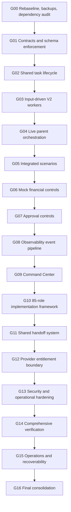

# Wejdan Life OS — dependency graph (G00 baseline)

This graph records the strict gate order in the owner-provided execution instruction. Each gate depends on the verified outputs of the immediately preceding gate; later gates cannot start while the current gate is incomplete.

## Current gate

G00 and G01 are **VERIFIED_COMPLETE**. G02 is **IN_PROGRESS**. G03–G16 are **NOT_STARTED**. This is a program dependency chain mandated by the request, not a claim that every technical artifact has a direct runtime dependency on its predecessor.

## Known runtime dependencies from the current n8n baseline

- Pilot (`KvMjR2lx81qsuCPL`) is a standalone manual-triggered synthetic flow.
- The four original standalone role/pilot flows are not connected to a cloud parent.
- Each V2 flow has a manual trigger and an `executeWorkflowTrigger` feeding its Code node. No verified parent calls these child workflows.
- Program Director and Finance Code nodes have input-processing logic. Observability V2 Code still returns fixed fixtures; treat it as not yet event-driven.
- Local `agent-mock-orchestrator-v2.json` is only a template and has no matching live workflow.
- All seven workflows are inactive; credential inventory is empty and exported nodes have no credentials.

## Source evidence

`ops/GATE_QUEUE.json`, `ops/WORKFLOW_REGISTRY.json`, `ops/G00_BACKUP_MANIFEST.json`, and `ops/G00_SOURCE_DRIFT.md`.

